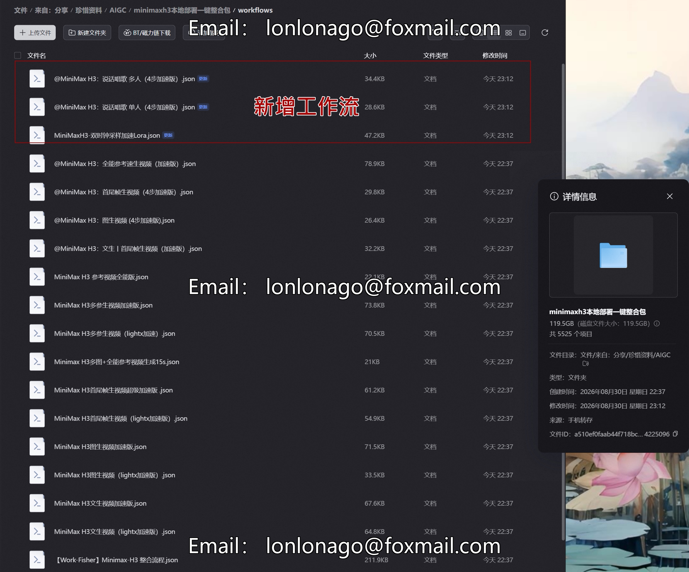

# New MiniMax H3 Video Generation Acceleration Edition Model Local Deployment Integration Pack

## Body

The new MiniMax H3 video generation acceleration model local deployment integration package, with a price range of tens of thousands, can run on N cards, and the generated effects can be comparable to similar video models. | The entire package is about 120G.

Product highlights
Locally run the deployment kit, organize related files properly to reduce the difficulty of deployment operations.
Compatible with consumer-grade NVIDIA graphics cards, independent of online interfaces.
Includes deployment documentation and operational guidelines, including troubleshooting references for common issues.

Equipment operation requirements

- Graphics Card: Supports only N20-60 dedicated graphics cards with an 8GB memory size for smooth operation.
- RAM: 32GB of running memory.
- Suitable for both regular gaming laptops and desktop hosts, without the need for top-tier graphics cards.
- Does not support AMD or MAC graphics cards.

Contents
Model-related files, dependencies, deployment tutorials for images and text, reference documents for basic parameters

Important Warning
Please communicate the computer hardware environment before purchasing, confirm whether the hardware is compatible, and if not, return will not be accepted.
Due to differences in computer hardware, driver versions, and system environments, the performance of different devices varies.
This is a virtual digital resource and does not support after the file delivery. It is only for personal study and research use, please do not resell or redistribute it.

## Images

## Payment

Here is a pay link on Stripe ( https://buy.stripe.com/3cs8yP7sY87d0vu9AB ). Please contact me lonlonago@foxmail.com after funding $89, and I will send you a complete data files , thank you!

